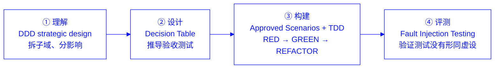

# 第一章 Agent 生成代码为什么不可信：读者的困境与四元素方法论

按照本书第二章到第五章的实操内容亲身体验下来，你会掌握一次就能让充满不确定性的 AI Coding Agent 为传统棕地软件开发项目生成**可信**测试和生产代码的技能。

AI 时代，知识本身已经不再稀缺——真正稀缺的是亲身经历一遍"诉求怎么被澄清、判断怎么被验证、哪里踩了坑"的完整过程。所以本章和接下来几章，不会只讲"理解 → 设计 → 构建 → 评测"这套方法论本身，还会展示作者在用这套方法论解决 `commons-csv` 这个真实需求时的亲身体验、所思所想和事后悟出的道理，并把作者实际发给 Agent 的完整提示词原样提供给你，方便你拿着与作者同款的提示词亲自跑一遍、积累属于你自己的亲身体验。

在动手实操之前，先问自己一个问题：**如果让 Agent 直接在 [`commons-csv`](https://github.com/apache/commons-csv) 代码库上实现一个 `required headers` 新需求（解析 CSV 时，一旦发现表头缺少某些约定好的固定列，就在读到第一条记录之前抛出一个清楚说明"缺了哪些列"的错误），你觉得会踩哪些坑？**

这个问题背后藏着五个具体的困境——它们并非孤立的抱怨，而是本章接下来要逐一拆解、并在第二至第五章用同一套方法论逐一化解的真实痛点。

> [!TIP]
> **TL;DR · 读完本章你会：**
> - 看清"编译通过、逻辑读起来也顺，但悄悄改变了原有行为"才是棕地项目里 Agent 代码不可信的真正杀手——而非语法错误；
> - 认清国内 token 不自由的 Agent Coding 开发者在棕地项目里会遇到的五个具体困境，以及它们背后共同的根源；
> - 认识贯穿全书的"理解 → 设计 → 构建 → 评测"四元素方法论及其独特的实现方法，看清这些实现方法分别如何针对性地化解上述五个困境，以及它为什么必须环环相扣、少一步都会打折扣；
> - 知道全书唯一的贯穿案例——Apache Commons CSV 的 `required headers` 新需求——以及本书的实操工具锚点。

**本章目录**：[1.1 棕地困境](#ch1-1) · [1.2 四元素方法论](#ch1-2) · [1.3 实操锚点](#ch1-3)

## 1.1 国内 token 不自由的 Agent Coding 开发者的棕地困境

为什么国内 token 不自由的开发者，真正怕的并非 Agent 代码写得烂——真正让人心惊的，是它"写得仅仅看着对"？如果你在国内用 Agent 写代码，大概率遇到过这样的约束：国际大模型 API 访问受限，走中转或本地代理风险和成本不低，国产口碑良好的大模型的订阅费也不便宜，企业内部对调用量又有配额限制。这些约束合在一起，指向一个现实——**多轮对话慢慢纠错这条路走不通**。国外很多"AI 编程最佳实践"默认你可以无限制地和模型来回对话，生成代码不满意就换个说法再问一次，直到模型"蒙对"为止。但当每一次调用都有成本、有配额，这种试错式的工作方式就变成了一种奢侈。

更棘手的是你要维护的软件本身的性质。本书讨论的读者画像，并非"正在开发 agent 系统的人"，说白了，其实就是**用 Agent 作为工具，去维护一个需要长期维护的传统非智能软件**的人——这个软件不限定于开源项目，可能是公司内部系统、客户交付的项目、或者任何已经上线运行、有存量用户、有其他模块依赖的代码库。这类项目有一个共同特征：代码里藏着大量"看不见的契约"——某个方法的空值处理方式、某个类的线程安全假设、某个 API 的向后兼容承诺。这些契约往往没有写在文档里，只活在程序员的脑子里和调用方的假设中。工程上把这类项目称为[棕地项目（Brownfield Project）](https://www.environmentalworks.com/what-is-a-brownfield-project/)（借用土木工程中的术语，指在老旧软件系统之上开发与部署新软件系统的项目），与从零开始、没有历史包袱的绿地项目（Greenfield Project）相对。

Agent 生成代码最危险的地方并非"编译不过"——这种错误立刻会暴露。真正危险的是**编译通过、逻辑读起来也顺，但悄悄改变了原有行为**。这种代码在棕地项目里是定时炸弹：它可能过了 code review，过了手工验证，直到某个边缘场景在生产环境触发，才暴露出问题。而一旦返工，代价往往是最初生成成本的数倍——包括重新调用 Agent 的 token 成本，也包括排查问题、修复问题、重新验证的人力成本。把这个根源拆开看，国内 token 不自由的开发者在棕地项目里会具体撞上五个困境。

#### 困境一：说不全、怕脑补歪——一次对齐诉求有多难

写提示词向 Agent 表达诉求时，很难一次把事情想清楚、说完整。经常是点击提交后，才忽然发现提示词里忘了说一个重要的约束，或者半道改了主意——这种返工不仅耗 token、费时间，还往往要等 Agent 把一大段代码都生成完才发现问题，返工成本随之放大。更麻烦的是另一面：Agent 虽然能对你没明说的诉求"脑补"一番，但脑补的方向经常是歪的——它按自己的理解把空白处填满，看起来煞有介事，实则跑偏，等你发现时已经是生成之后，又要推倒重来。国内 token 不自由的开发者对这两种返工尤其感觉痛——多轮对话纠错这条路本来就走不通，一次提示词没说清楚，代价是双倍的。

#### 困境二：隔靴搔痒又主次不分——该信 AI 讲的架构几分

让 AI 帮着理解陌生代码库时，一方面感觉隔靴搔痒，另一方面感觉主次不分。虽然 AI 能够生成漂亮的时序图，能把架构描述得头头是道，能解释难懂的代码，但 AI 讲的这些内容是真的在代码里发生了吗？哪些才是代码库的重点、需要精读？哪些并非重点，只需要浏览接口就行？没有一套能验证、能分主次的方法，AI 的讲解再漂亮，也只是一份听起来很对、却无法让你放心动手改代码的"说明文档"。

#### 困境三：测试用例凭感觉——覆盖够不够说不清

让 AI 帮着设计自动化验收测试时，总感觉 AI 给出的测试用例太随意了。AI 生成测试代码速度很快，但这些测试是怎么推导出来的？真的能覆盖所有相关的业务规则组合吗？我怎么知道这些测试是否出现了重复和遗漏？没有一套系统性的推导方法，测试用例清单看起来热热闹闹，实际上到底漏了哪些业务场景、又在哪些场景上重复用力，根本说不清楚。

#### 困境四：红变绿的猫腻——测试和生产代码一起被悄悄带偏

让 AI 帮着用 TDD 构建棕地项目的新需求或修复 bug 时，总担心 AI 会为了让测试运行通过，偷偷同时改动生产代码和测试代码——虽然测试变绿了，但这样改完之后，我怎么知道测试和生产代码是否已经一起偏离了业务本意？"测试通过"本该是一份值得信任的保证，但如果测试本身也被悄悄改动过，这份保证就形同自我证明，毫无意义。

#### 困境五：断言形同虚设——改坏代码测试却纹丝不动

让 AI 帮着用自动化测试验证棕地项目的生产代码是否正确时，总担心测试代码徒有其名。测试代码里的断言语句，针对的到底是真实的业务规则，还是"某个方法是否被调用过"这种鸡毛蒜皮的事？如果我把某个关键的业务代码故意改坏，相应的自动化测试真的能变红吗？会不会还是绿的？一份不会因为业务被破坏而变红的测试，和没有测试没有本质区别，只是看起来更让人安心而已。

对国内 token 不自由的开发者来说，上述五个困境背后是同一个约束叠加：**没有本钱靠多轮试错去逼近正确答案，又必须在充满隐性契约的棕地代码里工作**。这正是本书要解决的问题：如何让 Agent 在有限的 token 预算下，第一次生成就是可信的，而不靠事后反复纠正。

## 1.2 本书方法论：理解 → 设计 → 构建 → 评测

在有限预算下追求"一次生成可信"，有没有一条可复用的链路撑得住？核心思路是把"信任"从一句主观判断（"这段代码看起来没问题"）变成一条可执行、可验证的工程流程。本书贯穿全书的方法论由四个环节组成，这四个环节分别针对性地化解上一节的五个困境。

这四个环节都会先遇到困境一——向 Agent 表达诉求时很难一次说全，又怕 Agent 把没说清楚的地方脑补歪。所以本书给这四个环节相应的提示词，开头都统一加了一道"**假设体检加追问**"前缀：先让 Agent 列出它默认成立的隐含假设、列出它还缺的关键信息，再只问一个最关键的问题，等你确认之后才正式动手——而并非拿到诉求就直接埋头生成。这道前缀把"一次说全"的压力从你一个人身上卸下来，变成你和 Agent 共同核对的过程，脑补跑偏的概率也随之大幅降低。

**第一步：理解代码所承载的复杂业务逻辑。** 这一步专门应对困境二——AI 讲的架构、时序图听起来很有道理，但哪些是真的、哪些才是该精读的重点，光听 AI 说是说不清的。本书用两招组合解决：先**单步调试代码库里与新需求或bug修复相关的自动化验收测试**，亲眼盯着生产代码的执行路径走一遍，把"AI 讲的行为"和"代码里实际发生的行为"对齐，而并非只听 AI 转述；再用 [DDD（Domain-Driven Design）](https://www.oreilly.com/library/view/learning-domain-driven-design/9781098100124/) 的 strategic design——把代码库当作一个业务域来看，拆分出核心（core）、通用（generic）、支撑（supporting）子域，分清楚哪部分是"牵一发而动全身"的核心业务逻辑值得精读，哪部分是"随便换一个现成方案都行"的边角配置扫一眼接口就够。头脑中有了一幅全景图，后面的每一步都不会蒙圈。

**第二步：设计面向验收测试的 spec。** 这一步专门应对困境三——AI 给出的测试用例看起来热热闹闹，但到底是怎么推导出来的、有没有遗漏和重复，说不清楚。本书采用 [Decision Table Testing（决策表测试法）](https://www.virtuosoqa.com/post/decision-table-testing) 来做这件事——系统性地识别条件、定义条件取值、计算规则数、识别动作、填充并化简决策表，最后把每条规则转成一个验收测试用例，把"我觉得应该测这几种情况"的直觉列举，变成一套可追溯、不遗漏不重复的推导过程。

**第三步：构建面向业务不变式的自动化验收测试。** 这一步专门应对困境四——担心 Agent 为了让测试变绿，偷偷把生产代码和测试代码一起改歪。本书采用 **[Approved Scenarios](https://lexler.github.io/augmented-coding-patterns/patterns/approved-scenarios/)** 模式，结合 TDD（Test-Driven Development）的红/绿/重构节奏来做这件事：每个验收测试用例对应一份**基于不变的业务规则、产品经理也能读懂**的 markdown 格式 fixture 文件，这份 fixture 同时是"评审材料"和"测试真正读取并执行的唯一输入"，并非两份互相脱节、手工保持同步的东西；每新增一条验收测试，先确认它在当前代码下会失败（红），再让 Agent 在生产代码里做最小改动让它通过（绿），再把生产代码中的重复代码等坏味道重构掉。因为 fixture 钉死的是不变的业务事实，Agent 无论怎么改代码，都绕不开这份钉死的业务基准，测试和生产代码是否一起偏离了业务，评审 fixture 就能看出来。

**第四步：评测自动化验收测试确实保护了生产代码。** 这一步专门应对困境五——测试跑绿了，不代表断言真的盯着业务规则，它也可能是一个形同虚设的空测试，无论生产代码怎么改都不会变红。本书采用 **[Fault Injection Testing（故障注入测试）](https://www.geeksforgeeks.org/software-engineering/fault-injection-testing-software-engineering/)** 来验证这件事：在生产代码里人为、有针对性地引入一个与某条测试"保护意图"语义对应的故障，验证该测试确实变红、报错信息确实对应这段生产代码的行为；然后撤销故障，确认测试恢复变绿。"变红→报错对应→变绿"这个闭环如果成立，才能证明这条测试确实在保护对应的生产代码，而不只是摆设。

四步环环相扣：理解给出业务边界，设计给出系统性的验收标准，构建把验收标准变成受测试保护的代码，评测把"这些测试真的有用"变成可重复的证据。少了任何一步，链条都会断——没有理解，决策表的条件会找错地方；没有设计，构建阶段容易遗漏或重复测试场景；没有评测，再多的测试也无法排除"形同虚设"的可能。

这条方法论并非抽象口号，本书会在第二至第五章用同一个新需求、同一套真实实操过程逐一展开，并邀请你在自己的 Agent 环境里亲手跑一遍与作者同款的完整提示词，再和书里展示的我的亲身体验对比复盘。

## 1.3 本书的实操锚点：Apache Commons CSV + OpenCode + GLM 5.3

方法论怎么落到一个真实、体量适中的棕地项目上？方法论讲得再清楚，脱离真实代码库就只是空中楼阁。本书选择 [Apache Commons CSV](https://github.com/apache/commons-csv) 作为唯一的贯穿案例，用同一个新需求——给 `CSVFormat.Builder` 新增 `setRequiredHeaders(String...)`，让解析器在表头缺少约定好的固定列时，于读到第一条记录之前就抛出清楚说明"缺了哪些列"的错误——走完理解、设计、构建、评测四个环节。

选择 commons-csv 的理由有四点：

- **CSV 的业务场景容易理解。** 对账、数据导入、报表导出这类"按列读写一份表格数据"的场景几乎人人都打过交道，不需要先花时间学习一个陌生的业务领域，就能把精力集中在"方法论怎么用"这件事本身上。
- **是真实棕地项目，但体量适中。** Commons CSV 是 Apache 基金会维护的开源库，提供 CSV 文件的读写能力，被广泛用于生产环境。它有真实的历史包袱、真实的既有测试套件、真实的向后兼容承诺，但核心源码只有十余个类，一个人可以在合理时间内建立起完整的心智模型，不会被体量拖垮学习曲线。
- **抽象清晰，适合做子域拆分和决策表推导的教学案例。** 它的核心类职责划分明确：`CSVFormat` 负责描述"一种 CSV 方言"、`CSVParser` 负责把输入流解析成记录并支持按名访问、`CSVPrinter` 负责把数据写出为符合格式的 CSV 文本、`Lexer` 与 `Token` 是解析过程中的词法层。这种清晰的职责边界，方便把一个新需求精确落到某个子域、某几个类上，而不必牵动整个代码库——第二章会详细展开这张子域地图。
- **规则密集，天然适合决策表推导。** CSV 格式本身充满"在什么条件下、遇到什么输入、该有什么行为"的规则（表头缺列该怎么报错、大小写该不该敏感、和已有的重复/空列名校验该怎么交互），这类规则正是决策表测试法最擅长系统性梳理的需求类型。

工具链上，本书以 **OpenCode + GLM 5.3** 为实操锚点——这个组合不需要国际信用卡、不依赖受限的国际网络访问，对国内 token 不自由的读者更现实。但再次强调：本书讨论的方法不绑定特定工具和大模型，换成你自己常用的、国内外口碑良好的 AI Coding Agent 搭配大模型（如 Claude Code 搭配 Opus 5.5、Codex CLI 搭配 GPT 6.1 Sol、OpenCode V2 搭配 GLM 5.3、Pi 搭配 DeepSeek v4 pro、CodeBuddy 搭配 GLM 5.3 等），书中的提示词和方法论都能跑通。

---

五个困境讲清楚了，四元素方法论的分工也搭好了框架——但框架终究要落地才算数。第二章会把"理解"这一步具体落地：带你用单步调试摸清 `commons-csv` 现有的表头处理行为，再用 DDD strategic design 把整个代码库拆成核心、通用、支撑子域，精确定位 `required headers` 新需求真正该落脚的地方。这是整条方法论链路的第一环，也是后面设计、构建、评测三步能不能站得住的地基。

➡️ 下一章：[第二章 理解代码所承载的复杂业务逻辑](../ch02/README.md#ch2-top)
