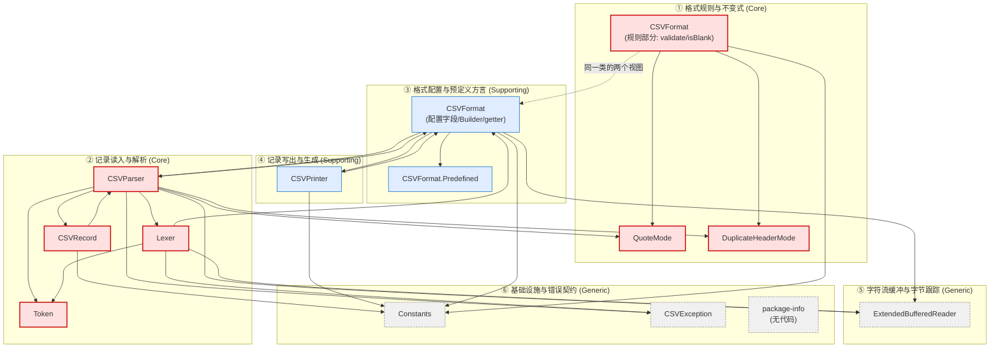
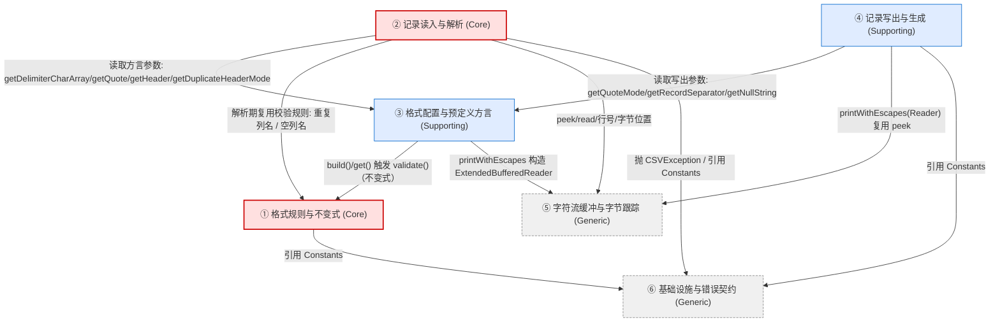

<a id="ch2-top"></a>

# 第二章 理解代码所承载的复杂业务逻辑

按照本章后面的提示词在你自己的 Agent 上实操一遍后，你将学会用单步调试和 DDD strategic design 快速理解一个陌生棕地代码库、分清核心业务逻辑与边角配置，并精确定位新需求会牵动哪些子域和类。

你接手了 `commons-csv` 这个陌生代码库，这个代码库需要你长期维护。最近你需要添加 `required headers` 新需求，你会如何在 Agent 的帮助下快速理解这个项目的软件架构，以便顺利添加新需求？

本章会用 DDD（Domain-Driven Design）的 strategic design 方法，带你走一遍"理解陌生棕地代码库、分清主次、分析新需求影响范围"的完整过程。

> [!TIP]
> **TL;DR · 读完本章你会：**
> - 学会先用单步调试代码库里现有的自动化验收测试，亲眼核实 AI 讲的代码行为是不是真的在代码里发生；
> - 学会用 DDD strategic design 把一个陌生棕地代码库拆成 core / generic / supporting 子域，分清哪里值得细读、哪里扫一眼接口就够；
> - 看到这套方法套在 `commons-csv` 上的真实判定结果——格式规则与不变式、记录读入与解析是 core，格式配置与预定义方言、记录写出与生成是 supporting，字符流缓冲与字节跟踪、基础设施与错误契约是 generic；
> - 学会识别"代码行数大≠业务逻辑复杂"这个最容易踩的坑；
> - 看到 `required headers` 新需求如何被精确定位到该落脚的子域和类，而非凭直觉改动。

<a id="ch2-toc"></a>
**本章目录**：[2.1 热身单步调试](#ch2-1) · [2.2 用 strategic design 理解陌生代码库](#ch2-2) · [2.3 识别核心、通用与支撑子域](#ch2-3) · [2.4 新需求影响分析](#ch2-4) · [2.5 动手练习提示词](#ch2-hands-on)

<a id="ch2-1"></a>

## 2.1 热身阶段单步调试指南：用现有行为的测试理解 commons-csv

> [!NOTE]
> 本节内容对应困境二——AI 讲的架构、时序图听起来很有道理，但哪些是真的在代码里发生的，光听转述说不清。在正式用 DDD strategic design 拆子域之前，先亲手单步调试一遍代码库里现有的验收测试，把"听 AI 说"换成"亲眼看代码真的怎么跑"。下面并非 Agent 产出文档的全文，而是我把本章 2.5 节的"热身提示词"发给 OpenCode V2 搭配 DeepSeek V4.1 Flash 之后，真实发生的问答过程、产出清单与可信度验证方式的复盘。建议你先快速浏览完这一节，再去跑 2.5 的提示词，跑完回来对照看看你的 Agent 给出的问题和产出有什么不同——我不会在这里重复讲 commons-csv 的内部实现，因为那样会搅乱你自己跑提示词后理解 Agent 与你的互动以及所生成的文档时的亲身体验。

### 过程：Agent 问了什么，我怎么答的

第一份热身提示词一发出去，Agent 先做了一轮环境核查（grep 确认 `setRequiredHeaders`/`RequiredHeader` 相关符号全库不存在、确认没有现成的 `kata` 子包、记录 JDK 21/Maven 3.9.16 和 `pom.xml` 里 `source/target=1.8` 的编译级别、确认工作目录是空的），然后只问了 Round 0 的一个问题：**这次热身到底是"为后续 TDD 铺路"、"为 DDD 分析积累业务手感"，还是"纯粹自己探险"**——这三种用途会让它选哪些场景、写多细的测试得出相反的结论。它自己给的默认推荐是"(a) 铺路为主、(b) 手感为辅"，我同意了这个选择方向，但没有照单全收它推荐里夹带的两个具体做法：它建议用 `git worktree` 克隆代码库以免污染源仓库，**我要求改成普通 `git clone`**；它还建议测试类"英文命名 + 中文注释"，**我要求全部按 Apache 项目惯例走（英文命名 + 英文注释）**，中文只留给最终产出的两份 markdown 文档。

前沿（frontier，由开发者 Matt Pocock 在风靡一时的[“grill-me”](https://github.com/mattpocock/skills/blob/main/skills/productivity/grilling/SKILL.md) skill 中创造的术语，指 Agent 澄清你的所求时当下最应该追问的问题列表，而并非那些需要依赖这些问题的答案才能往下问的后续问题，本书的“假设体检加追问”提示词参考了这一思路）打开后，Agent 一次性抛出 5 个问题：覆盖深度要到什么程度（它给了"最小集合/中等/穷尽"三档，建议中等——在需求原文点名的场景之外，再覆盖 `DuplicateHeaderMode` 三种取值、大小写不敏感、缺名容忍这些"默认值差异"）、是否要专门写一个"固化现状失败模式"的特征测试（断言 `record.get("currency")` 今天会怎么报错，作为后续 TDD 的红色基线）、调试指南写多细（自用 vs 兼顾未来读者）、"踩坑记录"放在哪个文件、以及克隆基线和改动要不要提交。我基本都同意了它的建议：覆盖深度选中等档、包含失败模式特征测试、调试指南按"自用可跑 + 兼顾未来读者"的标准写、踩坑记录并入调试指南末尾单开一节、新测试只留在工作区不提交。

和这一步并行，Agent 派了一个子代理去实地核查 `CSVFormat`/`CSVParser`/`CSVRecord`/`DuplicateHeaderMode` 的源码，取回精确行号和异常消息原文——这些事实收集不需要我回答，但报告回来后纠正了它自己此前问题里的一处疏漏：原来 Q1 选项里提到的 `getHeaderCount()` 之类的 API 其实根本不存在，它主动把这条从候选观察面里删掉，换成实测确认存在的 `getHeaderNames()`/`getHeaderMap()`/`isMapped(String)` 等。

### 产出：场景清单、调试指南、18 个特征测试

问题前沿清空后，Agent 产出了两份文档：

- **场景清单**（`ch02-1-1-scenarios-for-warming-up.md`）：先列出 35 个宽口径的 CSV 处理场景（S01～S35，覆盖表头来源、表头校验、按名/按下标取值、以及一组本轮有意不覆盖的其它行为），再从中挑出 19 个和"表头/必需列"直接相关的代表性场景并写明理由，最后给出场景与测试方法的对应表。
- **调试指南**（`ch02-1-2-debug-guide.md`）：开头给出复制即用的命令，正文按测试类（`HeaderResolutionTest`/`HeaderValidationTest`/`HeaderLookupTest`）逐个测试方法给出断点位置（类名+行号+该行代码）、要观察的变量、以及这个变量为什么能验证对应行为，并专门分析了 `setRequiredHeaders` 未来最合适的插入点——`CSVParser.createHeaders()` 返回之前（`CSVParser.java:682` 之前），因为此时 `headerMap` 已经完整建好，而这段代码又在构造函数（`CSVParser.java:528`）里被同步调用，天然满足"必须在读第一条记录之前报错"的约束。文末附一张行号对照表和一节"实测踩坑记录"。

这两份文档背后是真实写出并跑通的测试代码：`kata` 包下新增 3 个 JUnit 5 特征测试类——`HeaderResolutionTest`（6 个方法）、`HeaderValidationTest`（8 个方法）、`HeaderLookupTest`（4 个方法），共 18 个 `@Test`，435 行，已经公开在 [`commons-csv-by-opencode-v2-with-deepseek-v4.1-flash-2026-10-11-with-warming-up-debug`](https://github.com/wubin28/commons-csv-by-opencode-v2-with-deepseek-v4.1-flash-2026-10-11-with-warming-up-debug) 仓库的提交 [`7da9dc74`](https://github.com/wubin28/commons-csv-by-opencode-v2-with-deepseek-v4.1-flash-2026-10-11-with-warming-up-debug/commit/7da9dc74ef9a051de87aa00b229852e2aa0f0ba9) 里。这些测试只验证 commons-csv **今天已有**的行为，故意不实现 `setRequiredHeaders`——那是留给后面章节做 TDD 的事。

### 可信怎么实现的

这批测试和两份文档的可信度并非靠"读起来像专业文档"，而是靠一件可以直接复核的事：**18 个测试第一次跑的时候，有 3 个直接断言失败**——以为表头被消费后数据记录编号该从 2 开始，实测仍是 1；以为允许缺名列时空列名会被跳过，实测它照样被写进了映射（`headerMap` size 是 2 并非 1）；还有一处是关于 `DuplicateHeaderMode` 的"默认值陷阱"——`CSVFormat.DEFAULT`/`EXCEL` 的默认值 `ALLOW_ALL` 并非枚举或字段本身的 Java 默认值，而是 `CSVFormat.Builder.create()` 里显式设置出来的，换一条构造路径（`new Builder()`）就会变成等效于 `DISALLOW`。这些"我以为会这样、实测却打脸"的坑，都被原样记录进调试指南的"实测踩坑记录"一节，而并非悄悄把断言改对了就当没发生过。全量 `mvn test` 跑出 **1003 个测试、0 失败、0 错误、11 跳过**，这个数字本身也是可以在你自己的环境里重新跑一遍去验证的。

### 是否一把过

并非一次发出去就什么都对，但也没有真正的推倒重来。一个 Round 0 问题加 5 个编号问题，一轮就问完、前沿清空；真正动手之后唯一的"返工"（只是 Agent 在后台干活儿时默默自动小批量返工，并不是实操者手动从头返工），是 3 处测试断言被实测结果纠正——这些纠正都发生在"写完测试、第一次跑"的阶段，改的是断言本身（因为最初的预期是错的），并非推翻已经写好的测试结构重新设计。两处我主动否决 Agent 默认推荐的地方（克隆方式、命名风格），也是在 Round 0 一次性定下来的，没有产生后续返工。

<a id="ch2-2"></a>

## 2.2 用 DDD 的 strategic design 快速理解陌生代码库并分清主次

<a id="ch2-def"></a>

#### 定义

Strategic Design 是 [《Learning Domain-Driven Design》](https://www.oreilly.com/library/view/learning-domain-driven-design/9781098100124/)（Vlad Khononov 著）第 1～4 章系统阐述的一套分析方法，核心是把一个业务域（business domain）拆解为若干子域（subdomain）——围绕同一批数据、同一批参与者、彼此紧密关联的一组用例集合——再根据"是否提供竞争优势""业务逻辑复杂度""波动性"三个维度，把每个子域归类为核心子域（core subdomain，公司区别于竞争对手的地方，必须自建、持续演进）、通用子域（generic subdomain，所有人都用同样方式做的事，应该买/用现成方案）或支撑子域（supporting subdomain，业务逻辑简单、没有竞争优势、但又没有现成方案可用，只能自建但不需要最优秀的人）。严格意义上的 strategic design 面向的是公司和团队，但这套分析工具同样可以类比映射到一个纯技术性的代码库上——把"库要解决的问题本身"当作业务域，把"这部分代码历史上改动、修 bug 的频率"当作波动性，借此快速建立对陌生代码库的心智模型。

<a id="ch2-value"></a>

#### 价值

对棕地项目维护者来说，strategic design 最直接的价值是把"这个代码库到底哪里重要、哪里不重要"这个判断,从"读代码读得越多、感觉越对"的模糊直觉，变成一套可追溯、可复用的分析方法——识别出哪些类是"牵一发而动全身"的核心业务逻辑，哪些类是"换一个现成方案也无所谓"的边角配置，再根据业务职责判断一个新需求真正会落在哪个子域、哪些类，而不会被"这个方法挂在哪个类的 API 上"这个表面现象误导。

<a id="ch2-risk"></a>

#### 没有它的危害

没有这套分析工具时，理解一个陌生棕地代码库往往只能靠"从 main 方法或者某个入口类开始，顺着调用链慢慢读下去"，容易把"代码行数多、方法名花哨"误判为"这里很重要"，或者反过来，漏掉一个代码行数很少但真正承载着核心业务规则的类。更危险的是，在拆分新需求的改动范围时，如果没有先划清子域边界，很容易把一个本该只改一两个类的小需求，稀里糊涂地改成牵动好几个不相关模块的大改动——这正是本书第 1.1 节说的"棕地项目返工代价成倍放大"的典型成因之一。

<a id="ch2-strength"></a>

#### 独特优势

strategic design 提供了一套**与代码行数无关、只看业务规则复杂度**的分类标准，这恰好是 Agent 辅助编程场景里最容易被忽视的一点——Agent 很擅长"读懂一段代码在语法上做了什么"，但不一定天然具备"这段代码在业务上有多重要"的判断力，而后者恰恰是人在评审 Agent 产出时最该把关的地方。用 strategic design 的框架去追问 Agent（"这个子域提供竞争优势吗？复杂度高不高？"），能逼着 Agent 给出有理由、可追溯的判断，而并非一句笼统的"这个类很重要"。

<a id="ch2-weakness"></a>

#### 主要劣势

strategic design 原本是为公司和团队设计的分析工具，用在一个单一团队维护的技术库上是一次"方法论改造"——子域之间的协作关系，严格意义上该用本章末尾提示词中的书摘中的 Ch.4《Integrating Bounded Contexts》里"partnership / shared kernel / conformist / anticorruption layer / open-host service"这些描述**不同团队**整合关系的模式来说明，但技术库内部的子域往往生活在同一个 bounded context 里，这些模式在这里只能作比喻使用，不能按字面意义套用，使用时需要明确声明这一点，避免误导读者以为这是严格的教科书式用法。

<a id="ch2-fit"></a>

#### 适用场景

接手一个陌生的、体量中等（几十到大几百个类）、职责边界相对清晰的棕地代码库，需要在动手改动之前，先建立起"哪里是核心逻辑、哪里是边角配置"的心智模型；尤其适合在"一个新需求挂在某个支撑子域的 API 上，但真正的业务规则其实该落在核心子域里"这类容易被表面现象误导的场景。

<a id="ch2-nofit"></a>

#### 不适用场景

业务逻辑单一、简单且代码库体量极小，几个类就能全部读完（这种情况下，"子域"这个分析单元本身意义不大，不如直接读代码）；此外，如果团队本身就是多团队协作、跨 bounded context 的大型系统，Ch.4 的整合模式应该按字面意义严格使用，而并非作为比喻。

<a id="ch2-3"></a>

## 2.3 识别核心、通用与支撑子域

> [!NOTE]
> 从这里到本章"动手练习提示词"之间所展示的内容，就是作者在添加新功能之前“理解代码所承载的复杂业务逻辑”时与 OpenCode V2 搭配 DeepSeek V4.1 Flash 用"假设体检 + 追问"提示词共创出来的过程与产出要点（原产出内容较长，你应该没有耐心读完，所以这里只展示精华）。你可以先快速浏览，然后复制本章后半部分的[动手练习提示词](#ch2-hands-on)给你的 Agent ，自己动手跑一遍，再回来和本章上述所展示的内容对比复盘，看看自己的产出有什么差异、这些差异是否合理。

> [!IMPORTANT]
> 上述本章所展示的内容，都经过作者本人验证。由于大模型的不确定性，你把本章末尾的"动手练习提示词"发给自己常用的 Agent 和大模型组合后，会看到不完全相同的产出——这是很正常的现象。所以上述展示的内容，仅供你参考，而并非唯一答案。条条大路通罗马，解决问题的答案会有很多种。只要你理解了这份经过评审的参考结果背后的底层逻辑，再带着这份理解去评判你的 Agent 产出是否做到了"让 Agent 一次生成可信代码"，就已经能在亲身实践中有所收获。后面章节的我的动手实操参考内容的性质类同，不再赘述。

### 过程：Agent 问了什么、我怎么答、哪里猜错了

热身提示词一发出去，Agent 先做了一次环境核查（在工作目录里 grep 确认 `setRequiredHeaders` 确实不存在、JDK/Maven 版本、`pom.xml` 的编译级别），然后只问了我一个最关键的问题：**这次热身到底是"为后续 TDD 铺路"，还是"为 DDD 分析积累业务手感"，还是"纯粹自己探险"**——因为这三种用途会让它选哪些场景、写多细的测试得出相反的结论。我选了"铺路为主、手感为辅"。

前沿打开后，Agent 一次性抛出 5 个问题：测试覆盖多深（它建议覆盖 `DuplicateHeaderMode` 三种取值和大小写/缺名容忍这些"默认值差异"，而并非只覆盖需求原文点名的 4 类场景）、要不要专门写一个"固化现状失败模式"的特征测试（断言 `record.get("currency")` 今天会怎么报错，作为后续 TDD 的红色基线）、调试指南写多细、"踩坑记录"放哪、用哪个代码库基线。我基本都同意了它的建议，但纠正了两处它的默认假设：它一开始假设用 `git worktree` 克隆代码库以免污染源仓库，我要求改成普通 `git clone`；它还假设测试类"英文命名+中文注释"，我要求全部按 Apache 项目惯例走（英文命名+英文注释）。

子域分析提示词的 Round 0 同样只问了一个问题：这两份文档到底是"真要拿去给 commons-csv 提 PR"，还是"培训教学用的示范文档"，还是"我自己的学习笔记"——这个答案决定了子域判断该多精确、该不该为了教学把推理过程写透。我选了"教学为主、落地为辅"，于是 Agent 承诺"每条判定既写推理过程，又对齐真实可执行的类和方法"。接下来三轮一共问了 13 个编号问题，典型的像：读/写要不要拆成两个子域（我同意拆）、`CSVFormat` 这一个类要不要拆成"格式配置"和"格式规则与不变式"两个子域（我同意拆，因为新需求恰好落在"规则"这条线上）、要不要允许一次性、不入库的实跑代码去确证行为（我同意，因为光读 3369 行的 `CSVFormat` 源码很容易猜错分支）。

过程中出现了一次 Agent 自己纠正自己的插曲：它在表述 Q2 时把 `createHeaders()` 说成是写在 `CSVFormat` 里的，这其实是错的——它后来又主动 grep 复核了一遍源码，发现 `createHeaders()` 其实是 `CSVParser` 的私有方法，构建期校验在 `CSVFormat.validate()`，解析期校验在 `CSVParser.createHeaders()`，两者本来就分散在两个类里。它没有悄悄改掉前面的问题重新问一遍，而是在后续回复里直接列出"一处事实更正"，并指出这正好是 IMPACT_ANALYSIS 要写的一条关键事实。这件事给我的启发是：就算是 Agent 自己提出的技术判断，也要靠它自己或我去用 `grep`/实跑代码核验一遍，而并非读一遍源码就定论——这恰恰是本章方法论要解决的问题。

### 产出：6 个子域、哪个核心哪个通用哪个支撑、靠什么证据分出来的

问题前沿清空后，Agent 产出了文档 SUBDOMAINS （`ch02-2-1-subdomains.md`），把 commons-csv 这 12 个生产类收敛成 6 个子域：①格式规则与不变式（`CSVFormat` 的规则部分 + `QuoteMode` + `DuplicateHeaderMode`，判定 **Core**）、②记录读入与解析（`CSVParser`/`Lexer`/`Token`/`CSVRecord`，判定 **Core**）、③格式配置与预定义方言（`CSVFormat` 的配置部分 + `Predefined`，**Supporting**）、④记录写出与生成（`CSVPrinter`，**Supporting**）、⑤字符流缓冲与字节跟踪（`ExtendedBufferedReader`，**Generic**）、⑥基础设施与错误契约（`Constants`/`CSVException`/`package-info`，**Generic**）。每一条判定都按"竞争优势类比／复杂度／波动性／能否外包替代"四个维度写了依据，波动性这一项并非凭印象，而是真的跑了 `git log --oneline` 数出 `CSVFormat.java` 447 次提交、`CSVParser.java` 285 次、`CSVException.java` 只有 2 次——这组数字直接支撑了"规则和解析是核心、异常基类是通用件"的判断。文档里还特意留了一节"⚠️ 分歧/存疑"，老实写出"记录写出也可以被看作核心子域"这种反方观点，而并非把所有争议都抹平成一个确定结论。

这份文档还解释了一个我一开始也会犯的错：人们最容易把"技术分层"误当成"子域边界"，于是把代码最长、最底层的 `CSVFormat`/`Lexer` 一起封成"核心"，因为它们"最难、最长"；但按子域边界的标准，字符缓冲和词法切分其实是换哪个 CSV 库都要做的通用活，真正的核心是"识别一种 CSV 方言、定义合法格式的业务规则"。

子域分析引用了热身阶段真实产出的测试代码：`kata` 包下新增的 3 个 JUnit 5 特征测试类——`HeaderLookupTest`、`HeaderResolutionTest`、`HeaderValidationTest`，共 18 个 `@Test`，435 行，已经合并进公开仓库的提交 [`7da9dc74`](https://github.com/wubin28/commons-csv-by-opencode-v2-with-deepseek-v4.1-flash-2026-10-11-with-warming-up-debug/commit/7da9dc74ef9a051de87aa00b229852e2aa0f0ba9)。这些测试只验证 commons-csv **今天已有**的行为，故意不实现 `setRequiredHeaders`——留给后面章节做 TDD。

### 可信怎么实现的

子域判定能站得住，并非因为 Agent "读起来觉得合理"，而是靠三类真实证据：（1）真的通读了全部 12 个生产 `.java` 文件，而不只看类名猜职责；（2）凡是"波动性""默认值"这类可以实测的结论，都真的跑了 `git log` 或写了一次性不入库的验证代码去确证，读不出证据的地方会明确标注"证据不足，推测如下"；（3）文档里的两张 Mermaid 依赖图，Agent 用 `@mermaid-js/mermaid-cli` 真的渲染了一遍，过程中还发现并修了 2 处转义引号导致的语法错误——这意味着图并非"看起来像能画出来"，而是真的渲染通过的。

#### 类级依赖关系图

> 箭头 = 直接引用 / 调用 / 构造。虚线 = "同一个类的两个子域视图"。颜色 = Core/Supporting/Generic 对应红/蓝/灰。



**读图要点**

- `CSVParser` 是唯一的"中枢"：它同时依赖配置（`FMT_C`）、解析件（`Lexer`/`Token`）、模型（`CSVRecord`）、通用件（`EBR`）和错误契约（`EXC`）。
- 三对**双向依赖**：`CSVFormat ↔ CSVParser`（`CSVFormat.parse()` 造解析器，解析器读配置）、`CSVFormat ↔ CSVPrinter`（`CSVFormat.printer()` 造打印器）、`CSVParser ↔ CSVRecord`（记录回调解析器取表头映射）。
- `Lexer`/`Token`/`EBR`/`Constants`/`CSVException`/`QuoteMode`/`DuplicateHeaderMode` 都是**叶子**（无同包反向依赖）。

#### 子域依赖图（箭头上标注"接口是什么"）



热身阶段测试代码的可信度，则是靠"真的跑 `mvn test`"兑现的：18 个新测试第一次跑，有 3 个直接断言失败——比如以为表头被消费后数据记录编号该从 2 开始，实测仍是 1；以为允许缺名列时空列名会被跳过，实测它照样被写进了映射（size 是 2 并非 1）。这些"我以为会这样、实测却打脸"的坑，被原样记录进调试指南的"实测踩坑记录"一节，而并非悄悄把断言改对了就当没发生过。

### 是否一把过

并非"一次发出去就什么都对"，但也没有真正的推倒重来。两份提示词加起来走了好几轮"假设体检+追问"（热身прompt 1 个 Round 0 问题 + 5 个编号问题；子域/影响分析提示词 1 个 Round 0 问题 + 13 个编号问题，分 4 轮问完），这些轮次本身就是方法论设计出来的——目的是在动手写文档和代码之前，先把分歧和默认假设都挑出来。真正动手之后，唯一的"返工"是测试断言被实测结果纠正（3 处）和 Agent 自己发现并公开承认的一处事实性错误（`createHeaders()` 的位置），两者都是"发现错了就当场改、写进记录里"，没有出现"文档写完才发现子域分错了，整份重写"这种代价更高的返工。

<a id="ch2-4"></a>

## 2.4 新需求实现的影响分析

### 过程：围着"这个需求到底牵动谁"反复确认

影响分析和子域识别是同一份提示词、同一场对话产出的，所以 Round 0 的那个关键问题（教学为主还是落地为主）同样决定了影响分析要写到多细。确定"教学为主、结论对齐真实可执行的类和方法"之后，Agent 没有直接给结论，而是先按提示词要求**实地读代码**回答了"今天表头相关的校验分别发生在哪"：重复表头名校验分两处（`CSVFormat.validate()` 构建期、`CSVParser.createHeaders()` 解析期），都抛 `IllegalArgumentException`；空白/缺失表头名校验只在 `CSVParser.createHeaders()`；按名查找失败则在 `CSVRecord.get(String)`，正是需求原文抱怨的那个"迟报错"的点。

真正留给我决策的是最后 3 个问题（子域结构确定表、子域命名用中英双语、分歧怎么呈现），都是在前面 10 个问题定了调之后才能问的，我也都同意了建议。

### 产出：一条反直觉的结论、一张改动清单、6 个留白问题

IMPACT_ANALYSIS 文档（`ch02-2-2-impact-analysis.md`）最想讲清楚的一条结论是：**"需求挂在哪个类的 API 上"不等于"业务规则该落在哪个子域"，也不等于"规则真正被强制执行的地方"**。需求字面上说"给 `CSVFormat.Builder` 加一个方法"，第一反应是只改 `CSVFormat`；但真正的业务规则（"必需列必须存在"）属于核心子域①（格式规则与不变式），而规则的强制执行点却必须落在核心子域②（记录读入与解析），因为只有解析期才能拿到自动探测出来的真实表头——这恰好和现状里"重复列名校验分居构建期与解析期两处"是同一个结构。文档据此给出逐类改动清单：`CSVFormat`/`Builder` 新增 `requiredHeaders` 字段和 setter（供②访问）、`CSVParser.createHeaders()` 末尾新增必需列检查、`CSVRecord` 代码不改但其"晚报错"路径会被正常路径绕开；`CSVPrinter`、`Lexer`、`Token`、`ExtendedBufferedReader`、`Constants` 等明确标注"不受影响"。

文档末尾留了 6 个没有标准答案的开放设计问题：异常类型该复用 `IllegalArgumentException` 还是新建类型、校验要不要同时覆盖"显式表头"和"自动探测表头"两种来源、是否要跟随 `ignoreHeaderCase`、新校验和既有的空列名/重复列名校验谁先谁后报错、没有表头时 `requiredHeaders` 该怎么办、要不要对称处理写方向——每个问题都只写清楚"权衡点是什么"，不给作者自己的倾向，留给读者在第三章用决策表把它们一个个裁决掉。

### 可信怎么实现的

这份影响分析的可信度，建立在它和子域识别用的是**同一套实测证据**：现状校验的类名、方法名、行号、精确异常消息，全部来自前面"实地读代码+一次性实跑"验证过的事实报告，而并非另起一套凭印象写的说明。文档还特别验证了一致性——新需求的裂缝和"重复列名现状分居两处"的裂缝是同构的，这个类比本身就是一种交叉校验：如果影响分析得出的结论和已经验证过的现状规律自相矛盾，就说明判断错了。

### 是否一把过

同样并非零迭代，但没有返工：10 道前置问题问完、3 道收尾问题确认完，文档一次成型，没有出现"结论写完又推翻重写"的情况。唯一一次方向性纠正，就是 2.3 里提到的那次"`createHeaders()` 位置说错了"的自我更正——而这次更正恰好被顺手写成了 IMPACT_ANALYSIS 里"规则分居两处"这条关键事实的佐证，并非被动挨了一下批评才改，而是 Agent 检查出来主动讲清楚。


<a id="ch2-hands-on"></a>

## 2.5 动手练习提示词

为方便动手实操，本节提供**两份先后发给 Agent 的提示词**。第一份是"热身提示词"：在正式做 DDD 分析之前，先让 Agent 实地读一遍源码、动手写一批 JUnit 5 测试并跑通，建立对 `commons-csv` 现有行为的具体手感，而并非直接从抽象的"子域"概念入手。第二份是本章 2.3～2.4 节"识别子域"和"分析新需求影响"相应的提示词（合并成一份完整提示词，一次发给 Agent 后同时获得两份文档）。两份提示词都会先带你的 Agent 做一次"假设体检"，再按"追问"的方式和你对齐诉求，最后才真正动手。这正是全书反复强调的"假设体检+追问"工作习惯，在提示词层面的完整落地。建议你按顺序完整走一遍，而并不只看上面的参考内容。

使用前请注意：

- 两份提示词**各自独立使用、各自完整**——第二份并不假设你和 Agent 的对话还记得第一份的内容（你完全可以换一个新会话、甚至换一个 Agent 来跑第二份），所以第二份提示词里仍然带着完整的需求原文和 DDD 摘要附录，并不只是"见上一份提示词"这种引用式写法。第二份提示词原本要求 Agent 自己设计一遍"用来验证子域边界的端到端场景"，现在改成直接引用第一份提示词产出的场景清单文件（`ch02-1-1-scenarios-for-warming-up.md`）——所以**请先完整跑完第一份热身提示词，拿到场景清单文件之后，再跑第二份**。
- 两份提示词都要求 Agent **自己读源码、自己判断**，不会把本章 2.3～2.4 节的具体结论告诉它——这是故意的：先让你的 Agent 重新走一遍分析过程，再拿它的产出和本章内容对比，这样才有真实体验的效果。建议先完整跑完两份提示词、拿到全部产出之后，再回头翻 2.3～2.4 节对照。

提示词里有几处用尖括号标记的占位符，需要你替换成自己机器上的实际信息：

- `<CURRENT_DIRECTORY>`：你在 Agent 里设置的当前工作目录
- `<DIALOGS>.md（可以使用./ch02-0-dialogs.md）`：保存你和 Agent 之间对话记录的文件路径，已备 Agent 因为 LLM 服务暂时不可用等种种原因中断时能切换到其他 Agent 继续
- `<COMMONS_CSV_REPO_PATH>（可以使用./commons-csv）`：你要分析、也要在上面新增测试的代码库源码目录路径，可以从 `https://github.com/apache/commons-csv` 克隆到本地，并保存到当前工作目录下的 `./commons-csv` 子目录下——**两份提示词用的是同一份工作副本**：热身阶段新增的 JUnit 5 测试会和你后续章节继续做的生产代码改动共存在这份副本里，这是预期行为，不需要为热身阶段单独准备一份"用完就扔"的副本
- `<SCENARIOS_DOC_PATH>（可以使用./ch02-1-1-scenarios-for-warming-up.md）`：第一份热身提示词产出的"端到端测试场景清单"文档的相对路径（场景清单 + 挑出的代表性场景 + 场景↔测试方法对应表），第二份提示词会直接引用这份文件
- `<DEBUG_GUIDE_DOC_PATH>（可以使用./ch02-1-2-debug-guide.md）`：第一份热身提示词产出的单步调试指南文档的相对路径
- `<SUBDOMAINS_DOC_PATH>（可以使用./ch02-2-1-subdomains.md）`：第二份提示词产出的子域分析文档的相对路径
- `<IMPACT_ANALYSIS_DOC_PATH>（可以使用./ch02-2-2-impact-analysis.md）`：第二份提示词产出的影响分析文档的相对路径

既然 Agent 能够在你本地电脑上执行操作，那么推荐你在本地电脑为实操创建一个空目录，比如目录名可以叫 `<CURRENT_DIRECTORY>`；然后在终端里进入这个目录，并启动你常用的 Agent ，比如 OpenCode V2 ，并搭配你常用的大模型，比如 DeepSeek V4.1 Flash；之后就可以把已经替换好上述占位符的完整提示词依次复制给 Agent，开始实操。在"假设体检加追问"阶段，你能在这个目录中找到 Agent 生成的对话记录文件 `<DIALOGS>.md（可以使用./ch02-0-dialogs.md）` ，方便你查看，以及当 Agent 因故中断后能换一个 Agent 继续。

<details>
<summary>📋 第一份：热身提示词——先用单步调试熟悉陌生代码库（点击展开/折叠，可直接复制给 Agent）</summary>

提示词开始，请从这里往下全部复制

````
当前目录为

```
<CURRENT_DIRECTORY>
```

。请按照下面的要求完成任务，并在你每一次停下来等待我回复你的澄清问题时，将上一次追加前你我之间的完整对话（包括下面的Round 0）以markdown格式追加到

```
<DIALOGS>.md（可以使用./ch02-0-dialogs.md）
```

文件（如果这个文件不存在，就新建）末尾，以便我在回复你的问题前仔细阅读。下面是要求：

## 1. Round 0（假设体检）

在开始设计树之前，先执行 Round 0（假设体检）。

1.1 列出我下面要求里没有明说、但你已默认成立的假设（逐条编号，形如：A1、A2、A3……）；
1.2 列出你还缺哪些关键信息，并说明每条信息会如何改变你的方案（逐条编号，形如：M1、M2、M3……）；
1.3 指出人们处理这类问题时最常犯的一个错误；
1.4 只提一个最关键的问题 —— 这个问题要能帮你搞清我的真实目标和具体处境，而并非最后给我一份谁都能套用的通用建议。这个问题的格式如下：

```
❓ **Q0** - **<问题标题>**: <问题正文，可能包含多个段落及选项>

➡️ <你的建议答案>
```

## 2. 推进设计树

Round 0 只问上述这一个问题，不要提前问别的。我回答后，你再按追问的常规轮次（frontier / 编号问题 / 推荐答案）推进设计树，直到前沿清空。

## 3. 追问

按下面追问的要求追问我的诉求：

---
名称: 追问
描述: 针对某项计划、决策或想法，对用户进行深入且严密的追问。适用于用户希望压力测试其思路，或使用了任何触发"追问"模式的关键词句时。
---

对用户进行持续、深入的追问，直到双方达成共识。将此过程构建为一棵**决策树**：每一项决策都会衍生出后续相关的决策分支。

按**轮次**推进这棵树的构建。**前沿（frontier）**指的是那些前提条件已确定的决策——即你可以**立即**提问、而无需猜测尚未获知答案的问题。在每一轮中，提出"前沿"上的所有问题：为每个问题编号并给出你的建议答案。随后等待用户回答，再进入下一轮。

每个问题的格式应如下所示：

```
❓ **Q1** - **<问题标题>**: <问题正文，可能包含多个段落及选项>

➡️ <你的建议答案>
```

用户在每一轮的回答都会重塑决策树：已确定的决策会将"前沿"向外推进，并解锁那些依赖于这些决策的问题。重新计算"前沿"并进行下一轮提问。如果某个问题的答案依赖于本轮中尚未确定的另一个问题，则该问题应归入**后续**轮次，而非当前轮次。

发掘**事实**是你的职责，绝非用户的职责。当"前沿"上的某个问题需要获取环境（如文件系统、工具等）中的事实信息时，应指派子代理（sub-agent，如果有的话）去查找；切勿向用户询问你自己就能查到的信息。不要因此停滞不前：正在进行的探索属于尚未确定的前提条件，因此只有依赖于该探索结果的后续问题才需要等待子代理的报告；你可以立即提出"前沿"上的其他问题。**决策**权在于用户：将每一项决策提交给用户，并等待其回应。

## 4. 我的诉求

你是一名资深 Java 测试工程师，熟悉 JUnit 5，也熟悉用单步调试理解陌生代码库的方法。在我正式开始用 DDD strategic design 分析 `commons-csv` 这个陌生代码库之前，我想先做一次"理解现有代码库"的热身：实地读一遍源码、动手写一批测试并跑通，建立对这个库现有行为的具体手感，而并非一上来就谈抽象的"子域"概念。

### 背景

- 目标代码库（如果本地还没有，请先 `git clone https://github.com/apache/commons-csv` 到这个路径）：

```
<COMMONS_CSV_REPO_PATH>（可以使用./commons-csv）
```

这是一个标准 Maven 项目，已引入 `org.junit.jupiter:junit-jupiter`（JUnit 5）。

- 我接下来要在这个代码库上实现的具体需求（这是一个真实的 Apache Commons CSV 维护者可能收到的需求原文，供你理解"哪些现有行为值得优先弄清楚"）：

> 我在维护 Apache Commons CSV。我们对账时，上游 CSV 应当包含若干固定列。我想给 `CSVFormat.Builder` 加一个 `setRequiredHeaders(String...)`：解析时一旦发现表头缺少这些列，就在读第一条记录之前抛出一个清楚说明缺了哪些列的错误，而不用等业务代码调用 `record.get("currency")` 时才报 `Mapping for currency not found`。

- DDD Strategic Design 的背景知识摘要见本提示词末尾附录——你暂时不需要用它做任何子域判定（那是下一份提示词的任务），这里只是帮你理解"为什么表头相关的行为值得优先弄清楚"。

### 任务步骤

1. **阅读**：
   - 上面的需求原文；
   - 上述目标代码库相应目录下 `CSVFormat.java`、`CSVFormat.Builder`、`CSVParser.java`（尤其是构造函数和 `createHeaders()` 方法）、`CSVRecord.java`（尤其是 `get(String)` 方法）、`DuplicateHeaderMode.java` 的源码；
   - 本提示词末尾的"DDD Strategic Design 参考摘要"附录。

2. **列出"用来验证子域边界的端到端测试场景"**：基于你读到的源码和需求原文，列出一组典型的 CSV 文件处理端到端场景（数量不限，覆盖你认为有代表性的行为即可）。请把这份场景清单保存到：

```
<SCENARIOS_DOC_PATH>（可以使用./ch02-1-1-scenarios-for-warming-up.md）
```

3. **挑出与需求原文相关的代表性场景**：在上一步的场景清单里，挑出若干和"表头/必需列"这件事直接相关、值得动手验证的代表性场景——比如"读取**无表头** CSV，按**下标**取值"、"读取**带表头** CSV（**自动探测**第一行为表头），按**列名**取值"、"手工指定**表头 + 跳过首行**"、"**重复列名 / 空列名**的容错处理"等，具体覆盖哪些、覆盖多少由你自行判断。把挑选结果和理由也写进上述场景清单（场景清单 + 挑出的代表性场景 + 场景↔测试方法对应表，三部分都要有）里。

4. **为挑出的场景设计并运行端到端验收自动化测试**：
   - 用 **JUnit 5** 的 `@Test` 方法即可，不需要 Approved Scenarios 这种 markdown fixture 模式。
   - 这些测试只验证 `commons-csv` **当前已有**的行为（特征测试/characterization tests）——**不要**实现 `setRequiredHeaders(...)` 这个新功能，它还不存在，这是故意的（留给我在后面章节自己做 TDD）。
   - 测试代码写进上述目标代码库自己的 `src/test/java/org/apache/commons/csv/` 下的一个新子包里（比如 `kata` 子包），这样它能直接用这份代码库现成的 Maven 构建跑起来，并且会和我后续章节在同一份代码库上做的生产代码改动共存——这是预期行为。
   - 新文件如果会被 Apache RAT 一类的许可证头检查卡住，照着同目录下其他测试文件的写法加一份 ASF 许可证头。
   - 真的跑一遍 `mvn test`，确认新测试全部通过，并跑一遍全量测试，确认没有破坏任何已有测试。
   - 过程中如果踩到任何真实的坑（编译报错、断言和你预想的不一样、某个默认值和文档描述不一致等），都如实记录——这些"真实踩过的坑"比"看起来合理但没验证过"的内容更有价值。

5. **产出单步调试指南**：仿照"先列出断点位置，再说明观察哪些变量、为什么"的方式，把每个测试用例的单步调试要点写成文档，开头给出可以直接复制执行的命令（运行全量测试、运行这批新增测试），正文每个测试用例一节，包含：这个测试对应生产代码里的关键断点位置（类名 + 行号 + 该行语句原文，方便你在 IDE 里直接定位）、值得观察的变量（变量名 + 为什么看这个变量能验证对应的行为）、以及（如果适用）将来 `required headers` 新需求的生产代码可以插入在哪个类的哪一行、为什么插在那里能满足"必须在读第一条记录之前报错"这个约束。文档末尾附一张"行号对照表"。请把这份文档保存到：

```
<DEBUG_GUIDE_DOC_PATH>（可以使用./ch02-1-2-debug-guide.md）
```

### 输出要求

- 全文用中文撰写（代码标识符、类名、方法名保留英文原文，用反引号包裹）。
- 每一条断点、每一个"默认值是什么""行为是什么"的结论，都必须来自你实际读到的源码以及实际跑通的测试结果，不能是"通常应该是……"这种猜测；如果某处证据不足，请明确标注"证据不足，推测如下：……"。
- 不要在还没有实际跑通 `mvn test` 之前，就在调试指南里断言某个测试"会通过"。

## 附录：DDD Strategic Design 参考摘要

以下内容是《Learning Domain-Driven Design》（Vlad Khononov 著）第 1–4 章要点的概括整理，帮助你理解"为什么要先弄清楚表头相关的现有行为，而并非其他代码"——你暂时不需要用它做子域判定，只需要理解"核心子域的业务规则，往往就是最值得优先用测试和单步调试搞清楚的那部分代码"这个背景。

### 第 1 章《Analyzing Business Domains》要点

- **业务域**（business domain）：公司提供给客户的主要服务领域。公司要在业务域里成功，需要同时运作在多个**子域**（subdomain）——更细粒度的业务活动单元，彼此协作才能支撑整体业务。
- **核心子域（core subdomain）**：公司区别于竞争对手的地方——可能是发明新产品/服务，也可能是优化已有流程来降低成本。核心子域天然复杂（简单的东西很快会被竞争对手抄走），需要高准入门槛，要求公司自己投入最优秀的人、用最先进的工程手段**自建**，而且会持续演进（不存在"做完了"的核心子域）。判断一个子域是不是核心的小技巧：问自己"这个子域能不能单独拿出来做成一家公司，别人会不会为它单独付钱？"——能，就是核心子域。
- **通用子域（generic subdomain）**：所有公司都用同样方式在做的事情（比如身份认证）。同样复杂、同样难，但**不提供任何竞争优势**——已经有久经考验的现成方案，没必要自己发明，策略上应该"买/用开源方案"而并非自建。
- **支撑子域（supporting subdomain）**：业务逻辑简单（基本就是数据录入界面和 ETL/CRUD 操作），不提供竞争优势，但公司运转离不开它，又没有现成的通用方案可以直接用，所以只能自己写，可以外包或交给新人练手，不需要用最先进的工程技术。
- 三者对比（竞争优势 / 复杂度 / 波动性 / 实现策略）：

  | 类型 | 竞争优势 | 复杂度 | 波动性 | 实现策略 |
  | --- | --- | --- | --- | --- |
  | Core | 有 | 高 | 高 | 自建，最优秀的人 |
  | Generic | 无 | 高 | 低 | 买/用现成方案 |
  | Supporting | 无 | 低 | 低 | 自建/可外包 |

- **重要提醒**：核心子域不一定是"技术性"的（比如可能是珠宝设计这种和代码无关的事）；反过来，判断"软件相关的核心子域"时，要看**要实现的业务逻辑复杂度**——是像数据录入/CRUD 一样简单，还是需要实现复杂算法/被复杂业务规则和不变式编排的流程？前者是支撑子域的信号，后者才是核心子域的信号。**代码量大小并非判断标准**，业务逻辑的复杂度才是。
- **如何找子域边界**：从公司部门这种粗粒度单元开始，但往下细挖（distill），直到找到"一组围绕同一批数据、同一批参与者、彼此紧密关联的用例集合"——这就是子域的精确边界（"subdomains as coherent use cases"）。核心子域要尽量挖得精细（因为它最重要、最该聚焦投入）；通用/支撑子域如果继续往下挖不能带来新的设计决策信息，就可以停止。
- **域专家（domain experts）**：对业务领域了如指掌的人，通常是提出需求的人或软件的最终用户，既非分析师，也非工程师。

### 第 2 章《Discovering Domain Knowledge》要点

- **ubiquitous language（通用语言）**：让所有相关方（域专家、工程师、产品等）用同一种语言描述业务领域，避免"翻译链"（业务知识 → 分析模型 → 需求 → 设计 → 代码，每一步都会失真）。
- 这门语言必须是**业务语言**，不含技术术语（不说"iframe 显示 HTML"，而说"广告位展示创意素材"）。
- 语言必须**一致**：每个术语只能有一个含义，不能有歧义或同义词并存。
- 这个语言只在**特定边界内**保持一致（这就引出了第 3 章的 bounded context）。

### 第 3 章《Managing Domain Complexity》要点

- 当同一个术语在不同部门/场景下有不同含义（比如"lead"在市场部和销售部的含义不同）时，不能强行用一个模型覆盖所有场景，而要把通用语言拆分成多个更小的语言，每个语言只在自己的**bounded context（边界上下文）**内保持一致。
- **bounded context 是被设计出来的，subdomain 是被发现出来的**：子域是业务本来就存在的结构（不管你写不写软件，业务都是按这些子域运作的）；bounded context 是工程师为了实现软件系统主动做的设计决策（怎么划分模型边界、怎么划分团队和物理部署单元）。
- 一个 bounded context 可以只对应一个子域，也可以装下好几个子域（这完全取决于设计决策，并非固定规则）。但不要把"一个内聚的功能"硬拆到多个 bounded context 里，否则会导致本该一起变化的东西被迫分别维护、分别发布。
- bounded context 同时是**模型边界**、**物理部署/技术栈边界**、和**团队所有权边界**（一个 bounded context 只能由一个团队负责，但一个团队可以负责多个 bounded context）。

### 第 4 章《Integrating Bounded Contexts》要点

- **cooperation（合作类，团队间沟通顺畅时用）**
  - *Partnership（伙伴关系）*：两个团队非正式地协调集成，谁改了接口就通知另一方，双方一起解决集成问题。
  - *Shared kernel（共享内核）*：多个 bounded context 共用同一份模型/代码，任何改动必须同步触发所有相关方的集成测试。
- **customer–supplier（客户-供应商类，上下游团队可以独立成功，存在权力不对等）**
  - *Conformist（随从者）*：下游完全接受上游的模型，不做任何转换。
  - *Anticorruption layer（防腐层，ACL）*：下游不愿意接受上游模型，自己写一层转换，把上游模型翻译成适合自己的模型。
  - *Open-host service（开放主机服务）*：上游主动把"对外发布的接口模型"和"内部实现模型"解耦，设计一套专门给消费者用的、稳定的"published language"。
- **separate ways（分道扬镰，不集成，各自重复实现）**：当团队间沟通成本太高、或者要集成的是一个"集成成本比重复实现还贵"的通用子域时，宁可各自重复实现，也不集成。**核心子域不应该用这个模式**。
- **context map（上下文地图）**：把所有 bounded context 和它们之间用的整合模式画成一张图，给出系统的高层设计、团队协作模式、以及潜在组织问题的洞察。
````

提示词结束，以上内容请整段复制给 Agent。

</details>

<details>
<summary>📋 第二份：识别子域 + 分析新需求影响（点击展开/折叠，可直接复制给 Agent）</summary>

提示词开始，请从这里往下全部复制

````
当前目录为

```
<CURRENT_DIRECTORY>
```

。请按照下面的要求完成任务，并在你每一次停下来等待我回复你的澄清问题时，将上一次追加前你我之间的完整对话（包括下面的Round 0）以markdown格式追加到

```
<DIALOGS>.md（可以使用./ch02-0-dialogs.md）
```

文件（如果这个文件不存在，就新建）末尾，以便我在回复你的问题前仔细阅读。下面是要求：

## 1. Round 0（假设体检）

在开始设计树之前，先执行 Round 0（假设体检）。

1.1 列出我下面要求里没有明说、但你已默认成立的假设（逐条编号，形如：A1、A2、A3……）；
1.2 列出你还缺哪些关键信息，并说明每条信息会如何改变你的方案（逐条编号，形如：M1、M2、M3……）；
1.3 指出人们处理这类问题时最常犯的一个错误；
1.4 只提一个最关键的问题 —— 这个问题要能帮你搞清我的真实目标和具体处境，而并非最后给我一份谁都能套用的通用建议。这个问题的格式如下：

```
❓ **Q0** - **<问题标题>**: <问题正文，可能包含多个段落及选项>

➡️ <你的建议答案>
```

## 2. 推进设计树

Round 0 只问上述这一个问题，不要提前问别的。我回答后，你再按追问的常规轮次（frontier / 编号问题 / 推荐答案）推进设计树，直到前沿清空。

## 3. 追问

按下面追问的要求追问我的诉求：

---
名称: 追问
描述: 针对某项计划、决策或想法，对用户进行深入且严密的追问。适用于用户希望压力测试其思路，或使用了任何触发"追问"模式的关键词句时。
---

对用户进行持续、深入的追问，直到双方达成共识。将此过程构建为一棵**决策树**：每一项决策都会衍生出后续相关的决策分支。

按**轮次**推进这棵树的构建。**前沿（frontier）**指的是那些前提条件已确定的决策——即你可以**立即**提问、而无需猜测尚未获知答案的问题。在每一轮中，提出"前沿"上的所有问题：为每个问题编号并给出你的建议答案。随后等待用户回答，再进入下一轮。

每个问题的格式应如下所示：

```
❓ **Q1** - **<问题标题>**: <问题正文，可能包含多个段落及选项>

➡️ <你的建议答案>
```

用户在每一轮的回答都会重塑决策树：已确定的决策会将"前沿"向外推进，并解锁那些依赖于这些决策的问题。重新计算"前沿"并进行下一轮提问。如果某个问题的答案依赖于本轮中尚未确定的另一个问题，则该问题应归入**后续**轮次，而非当前轮次。

发掘**事实**是你的职责，绝非用户的职责。当"前沿"上的某个问题需要获取环境（如文件系统、工具等）中的事实信息时，应指派子代理（sub-agent，如果有的话）去查找；切勿向用户询问你自己就能查到的信息。不要因此停滞不前：正在进行的探索属于尚未确定的前提条件，因此只有依赖于该探索结果的后续问题才需要等待子代理的报告；你可以立即提出"前沿"上的其他问题。**决策**权在于用户：将每一项决策提交给用户，并等待其回应。

## 4. 我的诉求

你是一名资深 Java 架构师，同时也是一名 Domain-Driven Design（DDD）strategic design 教练。我是一名正在学习 DDD 的后端工程师，熟悉 Java，但没有系统学过 DDD。我需要你带我用 DDD strategic design 的方法，分析一个我不熟悉的开源代码库 **Apache Commons CSV**，帮我快速建立对它的心智模型，为后续做一次"棕地新增需求"练习做准备。

请严格按照下面的步骤和输出格式执行，不要跳步，不要先给结论再补过程。

## 4.1 任务目标

产出两份 Markdown 文档：

- **文档 SUBDOMAINS（子域识别）**：识别 commons-csv 代码库里的所有 subdomain，标注每个子域包含的 Java 类名、职责、对外接口、相互依赖关系，然后判断每个子域是 core / generic / supporting，并说明依赖关系与接口。请以markdown格式将上述文档 SUBDOMAINS 保存到以下文件中：

```
<SUBDOMAINS_DOC_PATH>（可以使用./ch02-2-1-subdomains.md）
```

- **文档 IMPACT_ANALYSIS（新需求影响分析）**：假设要在这个代码库上新增一个具体需求（需求原文见 4.6 ），分析这个需求会牵动哪些子域、哪些类，子域之间的接口会发生什么变化。请以markdown格式将上述文档 IMPACT_ANALYSIS 保存到以下文件中：

```
<IMPACT_ANALYSIS_DOC_PATH>（可以使用./ch02-2-2-impact-analysis.md）
```

这两份文档是用来帮我（以及其他和我一起培训的同学）熟悉这个陌生代码库的，所以**过程和依据比结论更重要**——请把"你是怎么判断出来的"写清楚，不要只给结论表格。

## 4.2 分析方法与必须遵守的几条原则

这些原则来自《Learning Domain-Driven Design》第 1–4 章，请参考本提示词 4.9 附录里的摘要。

## 4.3 判断 core / generic / supporting 的具体标准

请按下面四个维度逐一给出判断依据（对应 Ch.1 的分析框架），不要只写一句结论：

- **竞争优势类比**：这部分代码做对了，是不是这个库"选它而不选别的方案"的根本原因？
- **复杂度**：业务规则/边界条件复杂，还是本质上是数据录入/CRUD（存字段、读字段）？
- **波动性**：这部分历史上是不是改动最频繁、修 bug 最密集的地方？（如果你能访问 git log，可以实际查一下；如果不能，就基于代码本身的复杂度和注释里提到的"XX 版本修复了 XX 问题"之类的信息做合理推断，并说明这是推断而并非实测）
- **能否外包/用现成方案替代**：如果是"已经被解决过无数次的通用问题"（比如缓冲读取、编码转换），判定为 generic；如果"没有现成方案，必须自己维护"，且这正是这个库的价值所在，判定为 core；如果"逻辑简单，但没有现成方案，必须自己写"，判定为 supporting。

## 4.4 需要你分析的源代码

请分析下面这个目录下的全部 `.java` 生产代码文件（不包括测试代码、benchmark 代码）：

```
<COMMONS_CSV_REPO_PATH>（可以使用./commons-csv）
```

你应该有读取本机文件系统的能力：请直接遍历并读取该目录下所有 `.java` 文件。

对每一个类，请至少记录：职责（一两句话说清楚它实际做什么，而非复述类名）、对外公开的 API（构造方法/静态工厂方法 + 最重要的 5-15 个公开方法，次要的 getter 可以归类概括）、关键内部状态（字段，数量多的话归类概括）、它依赖哪些同目录下的其他类（以及这些类反过来是否依赖它——用来判断依赖方向，画依赖图要用）。

## 4.5 文档 SUBDOMAINS（子域识别）输出格式模板

请严格按下面的章节结构输出，章节标题可以根据你的实际发现调整文字，但结构（章节数量和顺序）要保持一致：

```
# <库名>：Strategic Design 子域识别

## 0. 分析前提：把一个"库"当作一个"业务域"来看
（本提示词 4.2 中第 1 条中要求的类比映射表格，以及这个类比本身作为"假设"的声明）

## 1. 用来验证子域边界的端到端场景
（不需要重新设计一遍——请直接读取并引用

```
<SCENARIOS_DOC_PATH>（可以使用./ch02-1-1-scenarios-for-warming-up.md）
```

这份文件里的场景清单，摘录/整理进本节；如果你是全新会话、还没有跑过"热身提示词"产出这份文件，请先完整执行热身提示词，拿到这份文件之后再回到这一步。在摘录的基础上，补充一段"这些场景分别落在哪些子域上"的交叉验证说明——这部分交叉验证是本节新增的分析，场景清单本身不用重新设计）

## 2. 子域清单（含类名、职责、依赖、接口）
（先说明包结构是扁平还是分层，据此说明划分粒度；然后逐个子域列出：包含的类 / 职责 / 对外接口 / 内部依赖）

## 3. 类级依赖关系图
（一张 Mermaid graph，把所有类按子域分组放进 subgraph，箭头表示直接引用/调用/构造关系，并用颜色区分后面判定的 core/generic/supporting）

## 4. 子域层面的依赖关系与"接口"
（一张 Mermaid graph，子域粒度，箭头上标注"接口是什么"；并附上 4.2 中的第 5 条要求的 bounded context 澄清说明，以及用 Ch.4 词汇做类比的 2-3 条说明）

## 5. Core / Generic / Supporting 判定
（表格：子域 | 判定 | 判定理由——理由要覆盖 4.3 中的四个维度；并单独写一段说明你是如何避免"代码行数=复杂度"这个常见错误的）

## 6. 小结表：子域 × 类 × 判定一览
（一张汇总表格）
```

## 4.6 文档 IMPACT_ANALYSIS（新需求影响分析）要分析的需求

假设这个代码库要新增下面这个具体需求（这是一个真实的 Apache Commons CSV 维护者可能收到的需求原文）：

> 我在维护 Apache Commons CSV。我们对账时，上游 CSV 应当包含若干固定列。我想给 `CSVFormat.Builder` 加一个 `setRequiredHeaders(String...)`：解析时一旦发现表头缺少这些列，就在读第一条记录之前抛出一个清楚说明缺了哪些列的错误，而不用等业务代码调用 `record.get("currency")` 时才报 `Mapping for currency not found`。

在分析这个需求之前，请先**用实地读代码的方式**（不要凭空猜测）回答：

- 今天这个库里，表头相关的校验（重复列名、空列名、按名访问找不到列）分别发生在哪个类的哪个方法里？分别在什么时机触发？抛出什么异常？
- 这些现状信息，决定了新需求的校验逻辑应该插在哪里（哪个方法、哪个时间点）——请说明你的推理过程，而并非直接给答案。

## 4.7 文档 IMPACT_ANALYSIS 输出格式模板

```
# 新增 "<需求简述>" 需求：子域影响分析

## 1. 需求复述（用已识别子域的 ubiquitous language 对齐）
（把需求原文里的用户语言，翻译成文档 SUBDOMAINS 里已经定义好的子域术语）

## 2. 现状：表头相关的校验已经发生在哪里
（表格：校验内容 | 发生在哪个类/方法 | 时机 | 抛出什么——基于 4.6 要求的实地代码核查）

## 3. 哪些子域被触碰、哪些不被触碰
（一张 Mermaid graph 标注每个子域"改/不改"；一张表格：子域 | 判定(来自文档A) | 本次需求是否触碰 | 说明；并给出一段"关键结论"——通常会发现"需求挂在哪个类的 API 上"和"真正的业务规则该落在哪个子域"并非同一回事，请specifically检查并指出这一点）

## 4. 逐类改动清单
（表格：类 | 子域 | 是否改动 | 具体改动 | 性质（新增/契约变化/不变））

## 5. 子域接口变化
（用 Ch.4 的词汇描述子域间契约如何演进，同时重申"是否跨 bounded context"的澄清；配一张 Mermaid 时序图，展示从调用方设置配置到最终抛出错误或返回第一条记录的完整时序，标出新增的检查步骤插在哪一步）

## 6. 留给学员现场决定的开放设计问题
（列出 4-6 个这个需求在实现时会遇到的、没有唯一正确答案的设计抉择，比如：异常类型怎么选、大小写/别名怎么处理、和已有校验逻辑的先后顺序和报错信息怎么组织、是否要对称地处理"反向操作"（如果这个库同时有读和写两个方向）、新配置项在"自动探测"和"手工指定"两种模式下是否行为一致等——每个问题要说清楚"权衡点是什么"，不需要给出你自己倾向的答案）

## 7. 小结
（表格：维度 | 结论——至少包含"牵动的子域"、"不受影响的子域"、"子域间接口变化"、"对训练目标的意义"四行）
```

## 4.8 输出要求

- 全文用中文撰写（代码标识符、类名、方法名保留英文原文，用反引号包裹）。
- 两张 Mermaid 图（文档 SUBDOMAINS 各一张，文档 IMPACT_ANALYSIS 至少一张）必须是语法正确、可以直接渲染的 Mermaid 代码块，不要用纯文字描述代替图。
- 表格优先于大段文字——凡是能用表格表达的结构化信息（子域判定理由、改动清单、校验现状），都用表格。
- 不要在还没有读完全部 12 个（或实际数量）源文件之前，就开始输出文档 SUBDOMAINS 或文档 IMPACT_ANALYSIS 的任何章节。
- 如果你发现某个类的职责、依赖关系，在源码里找不到足够信息支撑你的判断，请在文档里明确标注"证据不足，推测如下：……"，不要编造不存在的方法名或字段名。

## 4.9 附录：DDD Strategic Design 参考摘要

以下内容是《Learning Domain-Driven Design》（Vlad Khononov 著）第 1–4 章要点的概括整理，是你完成上面任务需要用到的全部 DDD 背景知识，不需要额外查阅其他资料。

### 第 1 章《Analyzing Business Domains》要点

- **业务域**（business domain）：公司提供给客户的主要服务领域。公司要在业务域里成功，需要同时运作在多个**子域**（subdomain）——更细粒度的业务活动单元，彼此协作才能支撑整体业务。
- **核心子域（core subdomain）**：公司区别于竞争对手的地方——可能是发明新产品/服务，也可能是优化已有流程来降低成本。核心子域天然复杂（简单的东西很快会被竞争对手抄走），需要高准入门槛，要求公司自己投入最优秀的人、用最先进的工程手段**自建**，而且会持续演进（不存在"做完了"的核心子域）。判断一个子域是不是核心的小技巧：问自己"这个子域能不能单独拿出来做成一家公司，别人会不会为它单独付钱？"——能，就是核心子域。
- **通用子域（generic subdomain）**：所有公司都用同样方式在做的事情（比如身份认证）。同样复杂、同样难，但**不提供任何竞争优势**——已经有久经考验的现成方案，没必要自己发明，策略上应该"买/用开源方案"而并非自建。
- **支撑子域（supporting subdomain）**：业务逻辑简单（基本就是数据录入界面和 ETL/CRUD 操作），不提供竞争优势，但公司运转离不开它，又没有现成的通用方案可以直接用，所以只能自己写，可以外包或交给新人练手，不需要用最先进的工程技术。
- 三者对比（竞争优势 / 复杂度 / 波动性 / 实现策略）：

  | 类型 | 竞争优势 | 复杂度 | 波动性 | 实现策略 |
  | --- | --- | --- | --- | --- |
  | Core | 有 | 高 | 高 | 自建，最优秀的人 |
  | Generic | 无 | 高 | 低 | 买/用现成方案 |
  | Supporting | 无 | 低 | 低 | 自建/可外包 |

- **重要提醒**：核心子域不一定是"技术性"的（比如可能是珠宝设计这种和代码无关的事）；反过来，判断"软件相关的核心子域"时，要看**要实现的业务逻辑复杂度**——是像数据录入/CRUD 一样简单，还是需要实现复杂算法/被复杂业务规则和不变式编排的流程？前者是支撑子域的信号，后者才是核心子域的信号。**代码量大小并非判断标准**，业务逻辑的复杂度才是。
- **如何找子域边界**：从公司部门这种粗粒度单元开始，但往下细挖（distill），直到找到"一组围绕同一批数据、同一批参与者、彼此紧密关联的用例集合"——这就是子域的精确边界（"subdomains as coherent use cases"）。核心子域要尽量挖得精细（因为它最重要、最该聚焦投入）；通用/支撑子域如果继续往下挖不能带来新的设计决策信息，就可以停止。
- **域专家（domain experts）**：对业务领域了如指掌的人，通常是提出需求的人或软件的最终用户，既非分析师，也非工程师。

### 第 2 章《Discovering Domain Knowledge》要点

- **ubiquitous language（通用语言）**：让所有相关方（域专家、工程师、产品等）用同一种语言描述业务领域，避免"翻译链"（业务知识 → 分析模型 → 需求 → 设计 → 代码，每一步都会失真）。
- 这门语言必须是**业务语言**，不含技术术语（不说"iframe 显示 HTML"，而说"广告位展示创意素材"）。
- 语言必须**一致**：每个术语只能有一个含义，不能有歧义或同义词并存。
- 这个语言只在**特定边界内**保持一致（这就引出了第 3 章的 bounded context）。

### 第 3 章《Managing Domain Complexity》要点

- 当同一个术语在不同部门/场景下有不同含义（比如"lead"在市场部和销售部的含义不同）时，不能强行用一个模型覆盖所有场景，而要把通用语言拆分成多个更小的语言，每个语言只在自己的**bounded context（边界上下文）**内保持一致。
- **bounded context 是被设计出来的，subdomain 是被发现出来的**：子域是业务本来就存在的结构（不管你写不写软件，业务都是按这些子域运作的）；bounded context 是工程师为了实现软件系统主动做的设计决策（怎么划分模型边界、怎么划分团队和物理部署单元）。
- 一个 bounded context 可以只对应一个子域，也可以装下好几个子域（这完全取决于设计决策，并非固定规则）。但不要把"一个内聚的功能"硬拆到多个 bounded context 里，否则会导致本该一起变化的东西被迫分别维护、分别发布。
- bounded context 同时是**模型边界**、**物理部署/技术栈边界**、和**团队所有权边界**（一个 bounded context 只能由一个团队负责，但一个团队可以负责多个 bounded context）。

### 第 4 章《Integrating Bounded Contexts》要点（仅在你分析的子域确实跨越了不同团队/不同 bounded context 时才按字面意义使用，否则只能作比喻）

- **cooperation（合作类，团队间沟通顺畅时用）**
  - *Partnership（伙伴关系）*：两个团队非正式地协调集成，谁改了接口就通知另一方，双方一起解决集成问题。
  - *Shared kernel（共享内核）*：多个 bounded context 共用同一份模型/代码，任何改动必须同步触发所有相关方的集成测试；适用场景之一是"同一个团队维护多个 bounded context，用共享内核明确划出一个本该一起管理的公共契约"。
- **customer–supplier（客户-供应商类，上下游团队可以独立成功，存在权力不对等）**
  - *Conformist（随从者）*：下游完全接受上游的模型，不做任何转换。
  - *Anticorruption layer（防腐层，ACL）*：下游不愿意接受上游模型，自己写一层转换，把上游模型翻译成适合自己的模型——适用于下游是核心子域、或上游模型很糟糕/变化频繁的情况。
  - *Open-host service（开放主机服务）*：上游主动把"对外发布的接口模型"和"内部实现模型"解耦，设计一套专门给消费者用的、稳定的"published language"，即使内部实现经常变，published language 也可以保持稳定或支持多版本并存平滑升级。
- **separate ways（分道扬镰，不集成，各自重复实现）**：当团队间沟通成本太高、或者要集成的是一个"集成成本比重复实现还贵"的通用子域（比如日志框架）时，宁可在各自的 bounded context 里各写一份，也不集成。**核心子域不应该用这个模式**，重复实现核心子域会违背"集中精力把核心子域做到最好"的战略。
- **context map（上下文地图）**：把所有 bounded context 和它们之间用的整合模式画成一张图，给出系统的高层设计、团队协作模式、以及潜在组织问题的洞察。
````

提示词结束，以上内容请整段复制给 Agent。

</details>

跑完整个流程后，把你的 Agent 产出的两份文档，和本章 2.3～2.4 节逐节对比——尤其关注 Round 0 阶段它对你的诉求提出了什么追问、有没有把"代码行数多"误判成"业务逻辑复杂"，以及"开放设计问题"这一节是否漏掉了某个需求原文没写清楚、但实际核查代码后才会发现的交互点（比如在`ch02-2-2-impact-analysis.md`的开放问题中，很多人直接假设两种 CSV 表头模式行为一致，却懒得去代码里确认）。下一章会把这些开放问题逐一裁决，并用决策表的方法推导出完整的验收测试用例。

子域地图画清楚了，新需求该落在哪几个类也有了结论——但 `ch02-2-2-impact-analysis.md`留下的几个开放设计问题还悬在半空，不裁决就没法往下写验收测试。第三章会先用一份轻量 ADR 把这些问题逐一拍板，再用决策表测试法把裁决结果系统性地推导成一份不遗漏、不重复的验收测试用例清单，这是"设计"这一步要交付的东西。

---

⬅️ 上一章：[第一章 Agent 生成代码为什么不可信](../ch01/README.md#ch1-toc) ｜ ➡️ 下一章：[第三章 设计面向验收测试的 Spec](../ch03/README.md#ch3-top)
